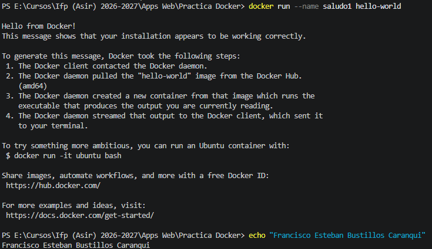
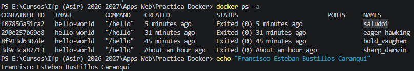
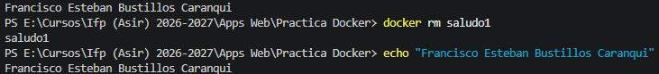
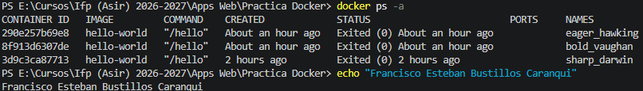
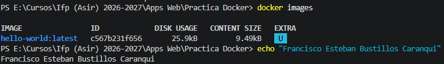
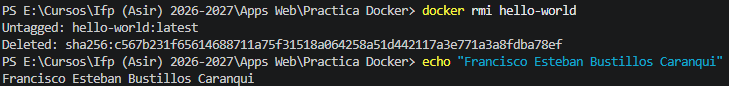
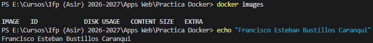
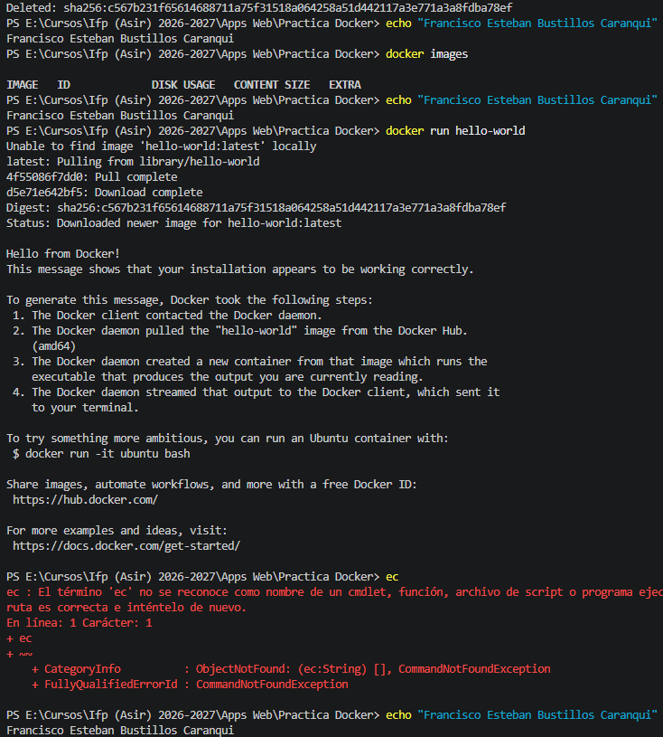

# Título 
Actividad Docker Contenedores Efimeros
# Nombre completo
Francisco Esteban Bustillos Caranqui
# Fecha
05/11/2026
## Parte 1: Ejecutar primer contenedor y observar ciclo de vida
### 1.1. Ejecución y Descarga
Ejecutamos el  comando :
``` docker run hello-world ```


### 1.2. Reflexiona y Documenta ¿Qué mensaje aparece?
Podemos ver las acciones que ha echo Docker. Debido a que el **Hello from Docker!**, nos indica que el contenedor arranco y imprimio el texto debido.
Ademas que el propio mensaje nos deja ver los debidos 4 pasos: el cliente se conectó al daemon de Docker, se descargó la imagen, se creó el contenedor y se mostró el resultado en la terminal.
#### Describe las acciones que Docker reporta haber realizado
* ```bash docker Unable to find image 'hello-world:latest' locally ``` Docker busca la imagen en el equipo y no la encuentra.
* ```Pulling from library/hello-world y Pull complete / Download complete``` La descarga desde Docker Hub.
* ``` Digest: sha256:... ``` La verificación. Es la huella única de la imagen, que garantiza que lo descargado, íntegro y auténtico.
* ``` Status: Downloaded newer image for hello-world:latest ``` La imagen quedó descargada sin problemas.
#### ¿Dónde reside la imagen ahora? 
La imagen se descargó desde Docker Hub y ahora está guardada en el almacén local de imágenes de Docker, es decir, en nuestro equipo.
Lo podemos comprobar con:
 ``` docker images ```

#### ¿Se ha eliminado después de la ejecución?
No. La imagen sigue en el equipo. Por eso, si volvemos a ejecutar docker **run hello-world**, ya no aparecerá “**Unable to find image...**” ni la descarga: arrancará directamente.


#### ¿Sigue "vivo" o terminó? 
El contenedor terminó ya que ejecutó el programa que mostró el mensaje y se detuvo. Como los contenedores funcionan mientras su proceso principal está activo, este finalizó rápidamente.

Lo podemos comprobar con ``` docker ps ```


#### ¿Cuál es el estado final de la tarea de este contenedor?
El contenedor está en estado ``` Exited (0) ```, lo que significa que terminó correctamente y sin errores. Aunque está detenido, sigue existiendo y se puede consultar o volver a ejecutar.

Podemos verlo en:
``` docker ps -a ```


### 1.3. Verificación contenedor detenido
#### Comprueba el estado del contenedor recién ejecutado. 
Como se ha indicado en el apartado anterior, el estado ```Exited (0)``` significa que el
contenedor terminó correctamente. El ```0``` es el código de salida, que por convención
indica éxito, mientras que cualquier otro valor indicaría error.

#### ¿Por qué tenemos que ejecutar el comando con el argumento –a?.
El comando ``` docker ps ``` muestra únicamente los contenedores que están funcionando.
Para mostrar todos los contenedores, incluidos los detenidos o finalizados, se utiliza ``` docker ps -a ```. El parámetro ``` -a ``` significa all


#### ¿Cuál es el CONTAINER ID (ID del Contenedor)? 
290e257b69e8
#### ¿Y el STATUS (Estado)?
Exited (0)
## Parte 2: Nombrar Contenedores para una mejor Gestión
En la Parte 1, Docker asignó un nombre aleatorio al contenedor. Aquí asignaremos un nombre para facilitar su identificación.
### 2.1. Ejecutar con Nombre Personalizado
Ejecuta el mismo contenedor, pero asignándole un nombre específico (saludo1) usando el
```flag --name:``` 

``` docker run --name saludo1 hello-world ``` 


### 2.2. Verificación y Reflexión. 
Comprueba la lista de contenedores detenidos
``` docker ps –a ```


### 2.3. Reflexiona y Documenta: 
#### ¿Qué diferencias notas en la columna NAMES?
Podemos ver que ahora aparece el nombre `saludo1` , porque al crear el contenedor utilizamos el parámetro `--name saludo1` para asignar un nombre personalizado. Esto nos permite identificarlo fácilmente en lugar de utilizar el nombre aleatorio que es asignado automáticamente.
#### ¿Por qué es útil asignar un nombre en lugar de depender del ID o del nombre aleatorio?
Es util usar identificadores ya que el Docker saigna nombres aleatorios que no nos permite saber facilmente para que sirve el contenedor, ya que podemos usar el nombre para mencionar brevemente para que sirve cada contenedor e identificarlo más rapido y facil.
## Parte 3: Limpieza de Contenedores Detenidos
Un contenedor detenido consume recursos mínimos, pero el sistema de archivos del contenedor
permanece. Debemos eliminarlo para liberar espacio y evitar el desorden.
### 3.1. Eliminación por Nombre
Elimina el contenedor saludo1 usando su nombre:
``` docker rm saludo1 ```


### 3.2. Verificación de la Eliminación
Comprueba que el contenedor ya no aparece en la lista de contenedores detenidos.
``` docker ps -a ```


## Parte 4: Limpieza de Imágenes
Hemos eliminado el contenedor, pero la **imagen** que se descargó para ejecutarlo (hello-world) sigue en tu
sistema local para futuras ejecuciones. También es importante eliminar imágenes que ya no se utilizan.
### 4.1. Listar Imágenes Locales.
Comprueba si la imagen hello-world está presente.

``` docker images ```


### 4.2. Eliminación de la Imagen.
Elimina la imagen por su nombre (hello-world).
``` docker rmi hello-world ```


### 4.3. Verificación Final.
Comprueba que la imagen ya no aparece en tu sistema.
``` docker images ```


### 4.4. Reflexiona y Documenta:
#### ¿Cuál es la diferencia fundamental entre docker rm y docker rmi?
La diferencia es que `docker rm` sirve para eliminar contenedores, mientras que `docker rmi` se utiliza para eliminar imágenes de Docker.
#### ¿Qué elimina cada uno? 
Docker rm saludo1, elimina el contenedor saludo1
Docker rmi hello-world, elimina la imagen hello-world
#### ¿Qué ocurriría si ahora intentaras ejecutar docker run hello-world de nuevo?
Ocurriría lo mismo que la primera vez: **Docker tendría que descargar de nuevo la imagen desde Docker Hub**, porque la eliminamos anteriormente con ```docker rmi hello-world``` y ya no está guardada en nuestro equipo.

